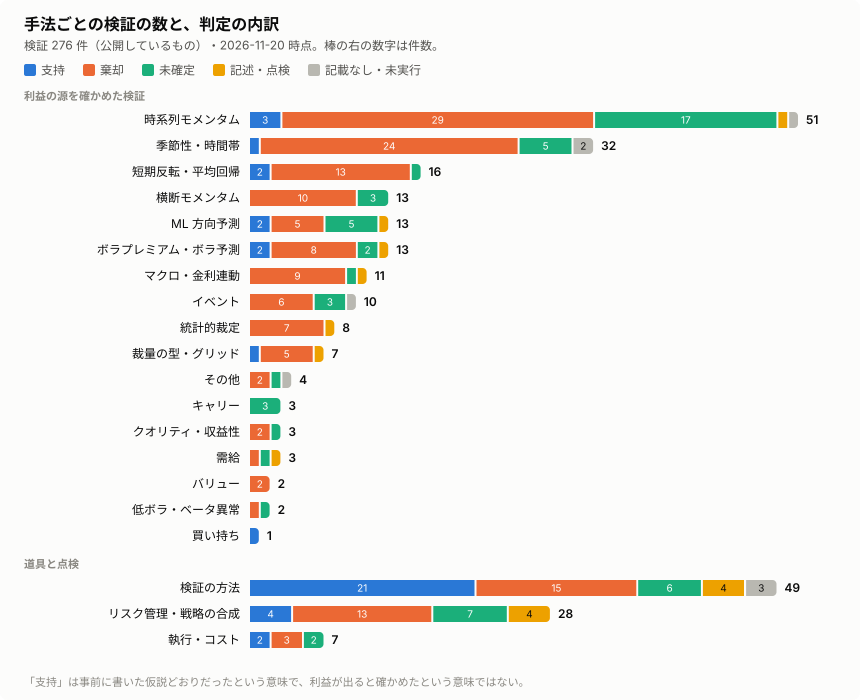
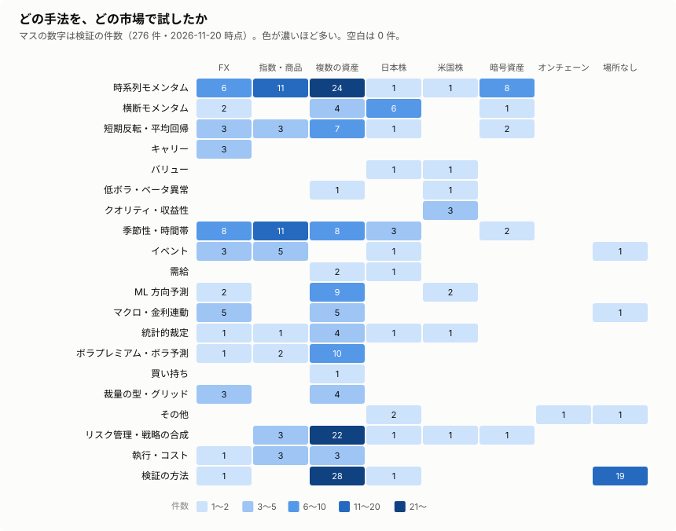

# システムトレードの検証と bot — 事前登録 → 検証 → 凍結 → 記録 → 執行

個人で続けている、売買ルールの検証と bot 制作の記録。
検証は 1 件 1 フォルダで、確かめた方向性（手法）ごとのフォルダに入れてある。棄却した検証も、そのまま残している。

- 見せたいのは成績ではなく、**結果を見てから規則を変えられない作り**（事前登録・封印期間・多重比較の補正）と、**記録と実際の注文を照合する作り**。
- 注文はすべてデモ口座。実際のお金は動かしていない。投資の助言ではない。
- 検証の大半は「効かなかった」という結果で終わっている。

## 構成

| 場所 | 中身 |
|---|---|
| `01_…/` 〜 `20_…/` | 検証。方向性ごとのフォルダの中に、検証 1 件 1 フォルダ（README・スクリプト・結果の要約）。各フォルダの `README.md` がその方向性の一覧 |
| [`bot/`](bot/README.md) | 検証を通ったものを凍結して記録し、MT5 で注文を出す部分（記録・執行・改ざんできない記録の仕組み・運用の決まり） |
| [`図の一覧.md`](図の一覧.md) | 全体の図、bot の記録の図、主な検証の図 |
| [`場所別.md`](場所別.md)・[`bot別.md`](bot別.md)・[`全件.tsv`](全件.tsv) | 検証を市場ごと・bot ごとに引く表と、機械で読む一覧 |

入れていないもの: 価格データ、凍結したモデルの本体（ハッシュだけ）、学習済みの中間ファイル、実行のログ、口座の設定。検証の一部は手元のデータが無いと動かない。

## 検証の一覧

> この表は生成物（2026-11-20）。手法・場所・判定の型は AI が付け、迷いのあるものと抜き取りを別の目で確かめた。

- **手法**: 何を利益の源（または道具）として確かめたか。
- **場所**: どの市場のデータで確かめたか。
- **判定**: 支持（事前に書いた仮説どおりだった）／棄却（仮説が立たなかった）／未確定／記述・点検（測って書いただけ）／記載なし・未実行（README に判定の行が無い・まだ走らせていない）。元の判定の文は各表にある。

## 全体の数

| | 件数 | 支持 | 棄却 | 未確定 | 記述・点検 | 記載なし・未実行 |
|---|---|---|---|---|---|---|
| 利益の源を確かめた検証 | 192 | 12 | 124 | 44 | 7 | 5 |
| 道具と点検（リスク管理・執行・検証の方法） | 84 | 27 | 31 | 15 | 8 | 3 |
| 計 | 276 | 39 | 155 | 59 | 15 | 8 |

## 利益の源を確かめた検証（手法ごと）

| 手法 | 件数 | 支持 | 棄却 | 未確定 | 記述・点検 | 記載なし・未実行 |
|---|---|---|---|---|---|---|
| [時系列モメンタム（トレンド）](01_時系列モメンタム/README.md) | 51 | 3 | 29 | 17 | 1 | 1 |
| [横断モメンタム](02_横断モメンタム/README.md) | 13 | 0 | 10 | 3 | 0 | 0 |
| [短期反転・平均回帰](03_短期反転・平均回帰/README.md) | 16 | 2 | 13 | 1 | 0 | 0 |
| [キャリー](04_キャリー/README.md) | 3 | 0 | 0 | 3 | 0 | 0 |
| [バリュー（長期反転）](05_バリュー/README.md) | 2 | 0 | 2 | 0 | 0 | 0 |
| [低ボラ・ベータ異常](06_低ボラ・ベータ異常/README.md) | 2 | 0 | 1 | 1 | 0 | 0 |
| [クオリティ・収益性](07_クオリティ・収益性/README.md) | 3 | 0 | 2 | 1 | 0 | 0 |
| [季節性・時間帯](08_季節性・時間帯/README.md) | 32 | 1 | 24 | 5 | 0 | 2 |
| [イベント](09_イベント/README.md) | 10 | 0 | 6 | 3 | 0 | 1 |
| [需給（建玉・信用・資金調達率）](10_需給/README.md) | 3 | 0 | 1 | 1 | 1 | 0 |
| [ML 方向予測](11_ML方向予測/README.md) | 13 | 2 | 5 | 5 | 1 | 0 |
| [マクロ・金利連動](12_マクロ・金利連動/README.md) | 11 | 0 | 9 | 1 | 1 | 0 |
| [統計的裁定（ペア・リードラグ）](13_統計的裁定/README.md) | 8 | 0 | 7 | 0 | 1 | 0 |
| [ボラプレミアム・ボラ予測](14_ボラプレミアム・ボラ予測/README.md) | 13 | 2 | 8 | 2 | 1 | 0 |
| [買い持ち（資産のリスクプレミアム）](15_買い持ち/README.md) | 1 | 1 | 0 | 0 | 0 | 0 |
| [裁量の型・グリッド](16_裁量の型・グリッド/README.md) | 7 | 1 | 5 | 0 | 1 | 0 |
| [その他](17_その他/README.md) | 4 | 0 | 2 | 1 | 0 | 1 |

## 道具と点検

売買の規則そのものではなく、規模の決め方・コストと執行・検証のやり方を確かめたもの。ここの「支持」は「その性質が確かめられた」という意味（例: 束ねた t 値は素朴な値より縮む）。

| 手法 | 件数 | 支持 | 棄却 | 未確定 | 記述・点検 | 記載なし・未実行 |
|---|---|---|---|---|---|---|
| [リスク管理・戦略の合成](18_リスク管理・戦略の合成/README.md) | 28 | 4 | 13 | 7 | 4 | 0 |
| [執行・コスト](19_執行・コスト/README.md) | 7 | 2 | 3 | 2 | 0 | 0 |
| [検証の方法（統計・データの点検）](20_検証の方法/README.md) | 49 | 21 | 15 | 6 | 4 | 3 |

## 手法 × 場所（件数。かっこは支持の数）

| 手法 ＼ 場所 | FX | 指数・商品 | 複数の資産 | 日本株 | 米国株 | 暗号資産 | オンチェーン・OP | 場所によらない | 計 |
|---|---|---|---|---|---|---|---|---|---|
| [時系列モメンタム（トレンド）](01_時系列モメンタム/README.md) | 6 | 11 | 24（3） | 1 | 1 | 8 |  |  | 51 |
| [横断モメンタム](02_横断モメンタム/README.md) | 2 |  | 4 | 6 |  | 1 |  |  | 13 |
| [短期反転・平均回帰](03_短期反転・平均回帰/README.md) | 3（1） | 3 | 7 | 1 |  | 2（1） |  |  | 16 |
| [キャリー](04_キャリー/README.md) | 3 |  |  |  |  |  |  |  | 3 |
| [バリュー（長期反転）](05_バリュー/README.md) |  |  |  | 1 | 1 |  |  |  | 2 |
| [低ボラ・ベータ異常](06_低ボラ・ベータ異常/README.md) |  |  | 1 |  | 1 |  |  |  | 2 |
| [クオリティ・収益性](07_クオリティ・収益性/README.md) |  |  |  |  | 3 |  |  |  | 3 |
| [季節性・時間帯](08_季節性・時間帯/README.md) | 8 | 11 | 8（1） | 3 |  | 2 |  |  | 32 |
| [イベント](09_イベント/README.md) | 3 | 5 |  | 1 |  |  |  | 1 | 10 |
| [需給（建玉・信用・資金調達率）](10_需給/README.md) |  |  | 2 | 1 |  |  |  |  | 3 |
| [ML 方向予測](11_ML方向予測/README.md) | 2 |  | 9（2） |  | 2 |  |  |  | 13 |
| [マクロ・金利連動](12_マクロ・金利連動/README.md) | 5 |  | 5 |  |  |  |  | 1 | 11 |
| [統計的裁定（ペア・リードラグ）](13_統計的裁定/README.md) | 1 | 1 | 4 | 1 | 1 |  |  |  | 8 |
| [ボラプレミアム・ボラ予測](14_ボラプレミアム・ボラ予測/README.md) | 1 | 2（1） | 10（1） |  |  |  |  |  | 13 |
| [買い持ち（資産のリスクプレミアム）](15_買い持ち/README.md) |  |  | 1（1） |  |  |  |  |  | 1 |
| [裁量の型・グリッド](16_裁量の型・グリッド/README.md) | 3（1） |  | 4 |  |  |  |  |  | 7 |
| [その他](17_その他/README.md) |  |  |  | 2 |  |  | 1 | 1 | 4 |
| [リスク管理・戦略の合成](18_リスク管理・戦略の合成/README.md) |  | 3 | 22（3） | 1（1） | 1 | 1 |  |  | 28 |
| [執行・コスト](19_執行・コスト/README.md) | 1 | 3（1） | 3（1） |  |  |  |  |  | 7 |
| [検証の方法（統計・データの点検）](20_検証の方法/README.md) | 1（1） |  | 28（11） | 1 |  |  |  | 19（9） | 49 |
| 計 | 39 | 39 | 132 | 19 | 10 | 14 | 1 | 22 | 276 |

## ほかの引き方

- [図の一覧.md](図の一覧.md) — 全体の図・bot の記録の図・主な検証の図
- [場所別.md](場所別.md) — 市場ごとに並べた表
- [bot別.md](bot別.md) — 記録中の bot（S 番号）に関わる検証
- [全件.tsv](全件.tsv) — 機械で読むための 1 枚（フォルダ・Q・手法・場所・判定の型・bot・公開）
- 記録（フォワード）まで進んだ bot の全体は `bot/トレード/戦略/<S番号>.md`、案と段階の正本は `bot/_基盤/戦略台帳.md`

## 読み方の注意

- **「支持」は「儲かる」ではない。** 事前に書いた仮説どおりだった、という意味。「この効果は 2015 年以降に消えた」という仮説が支持されたものも入る。次の関門（封印期間・実コスト・フォワード）で落ちたものも多い。
- 1 件に手法は 1 つだけ付けた。2 つにまたがるもの（例: 順張りに局面フィルタ）は、確かめたい部品の側に入れてある。
- 件数は検証フォルダの数で、試した規則の数ではない。1 つのフォルダに複数の問い（Q）が入っているものもある。
- 手法・場所・判定の型は、問いと判定の文から AI（Sonnet）が付け、迷いのあるものと抜き取りを別の目で確かめた。
