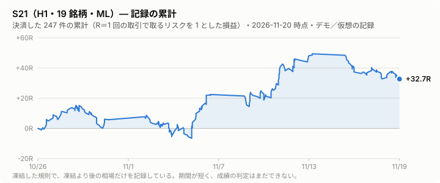
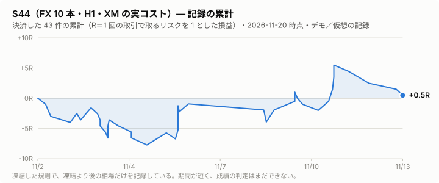
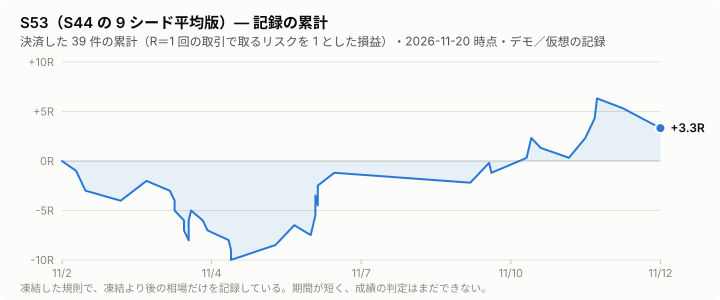
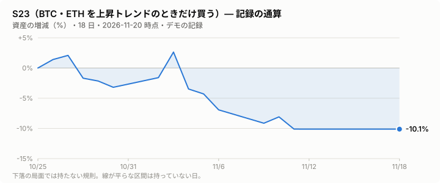
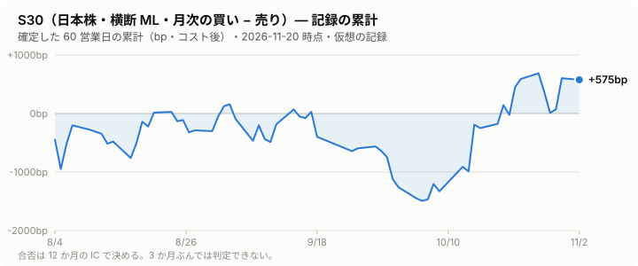
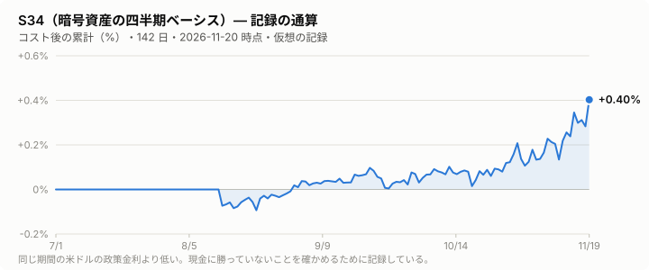

# bot — 検証を通ったものを「凍結 → 記録 → 執行」で動かす部分

売買 bot（FX・指数・暗号資産・日本株の 8 本）の、記録と執行の部分。手元の作業場所から決めたファイルだけを写してあり、パスは手元の `検証/` からの相対パスのまま（文書の中のパスは、この `bot/` を起点に読む）。

- 注文はすべてデモ口座。ここにある規則で利益が出ることは確かめられていない。
- 文書の中に出てくる `verification-lab/financial-engineering/<名前>/` は検証フォルダのこと。このリポジトリでは、方向性ごとのフォルダ（`../01_…/` など）の中にある。場所は [`../全件.tsv`](../全件.tsv) の「置き場」の列で引ける。

## 最初に読むもの

1. [`トレード/AGENTS.md`](トレード/AGENTS.md) — 全体の地図（どこに何があるか・動いているもの・触らないものと理由・用語）
2. [`_基盤/知識/bot要件_凍結_20261105.md`](_基盤/知識/bot要件_凍結_20261105.md) — 目的・物差し・制約・やらないこと
3. [`トレード/運用規程_フォワード_20261025.md`](トレード/運用規程_フォワード_20261025.md) — 1 回のリスク・止める線・実弾へ進む条件
4. [`トレード/戦略/`](トレード/戦略/) — bot ごとの 1 枚（仮説 → 検証 → 凍結 → 記録 → 執行をたどる索引）

## 記録の図

bot ごとの記録（フォワード）を、写しの中の記録のファイルから描いたもの。どれも期間が短く、成績の判定はまだできない。数字の正本は [`トレード/forward/記録_最新.md`](トレード/forward/記録_最新.md)。

S68 は記録が 2026-11-23 から、S17b は 4 日ぶんしか無いので、図にしていない。主な検証の図は [`../図の一覧.md`](../図の一覧.md)。

## 中身

| 場所 | 中身 |
|---|---|
| `トレード/forward/` | 記録（フォワード）。注文を出さず、凍結した規則で未来の相場の売買を計算して残す。bot ごとに `凍結/`（ハッシュ）と `記録/` |
| `トレード/forward/証拠/`・`_写し/` | 記録を後から書き換えていないことを示す仕組み（ハッシュの鎖・日ごとの写し・OpenTimestamps による第三者の時刻） |
| `トレード/forward/変更履歴.csv` | 規則・判断・記録用コードを変えたときの 1 行ずつの記録 |
| `トレード/執行/` | MT5 で注文を出す層。記録と同じ関数で判断し、記録と照合する。偽の MT5 を使った試験つき |
| `_基盤/` | 戦略の台帳（案・段階・関門・棄却した理由）と、運用の決まり |
| `自動実行/` | 見張り（状態の作り直し・通知）と、AI に無人で検証を進めさせるときの手順書 |
| `lab-ops/trade/` | 業者のスプレッドとスワップを測る道具、記録の鎖の先頭の控え |

## 入れていないもの

- 凍結したモデルの本体（`model_*.txt`）。ハッシュ（`凍結/hashes.json`）だけ入れてある。
- 価格データ（業者・取引所のデータは配り直せないため）。試験の一部は手元のデータが無いと動かない。
- 実行のログ、直しの前の控え（`*.orig_*`）、執行用 PC から届く状態、口座の設定。
