# 図の一覧 — 主な検証と bot

> 生成物（2026-11-20）。写しの中の記録と結果のファイルから描いた。数字は `bot/トレード/forward/記録_最新.md` と各検証の README が正本。

[← 表紙](README.md)

## 全体

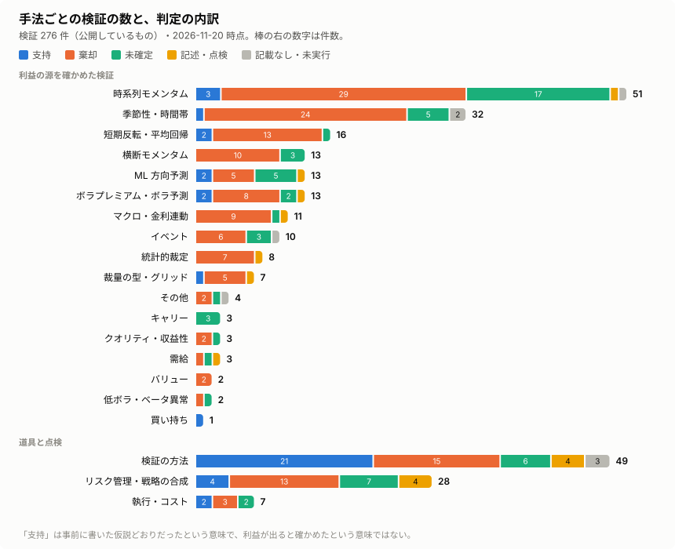

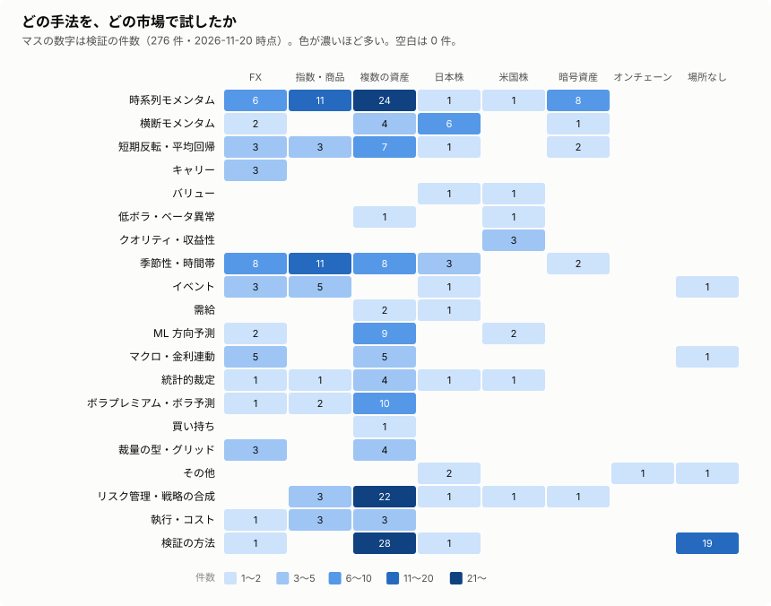

## bot の記録（フォワード）

注文を出さずに（S21 はデモ口座で注文も出して）、凍結した規則で凍結より後の相場だけを記録したもの。どれも期間が短く、成績の判定はまだできない。

### S21

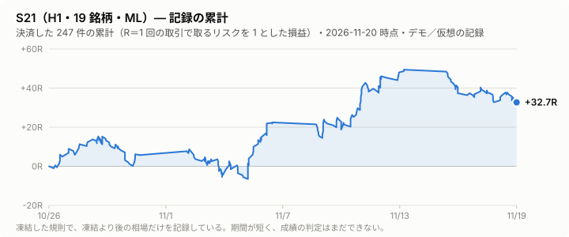

bot の全体: [`bot/トレード/戦略/S21.md`](bot/トレード/戦略/S21.md)

### S44

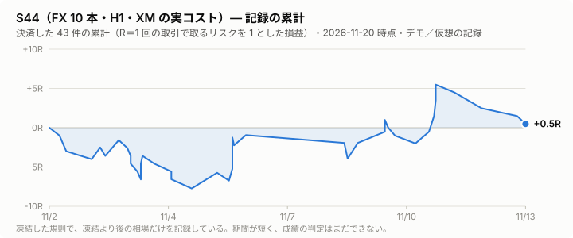

bot の全体: [`bot/トレード/戦略/S44.md`](bot/トレード/戦略/S44.md)

### S53

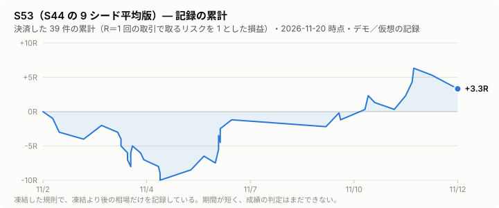

bot の全体: [`bot/トレード/戦略/S53.md`](bot/トレード/戦略/S53.md)

### S23

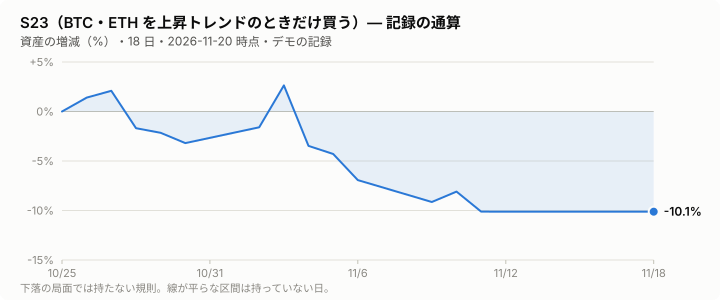

bot の全体: [`bot/トレード/戦略/S23.md`](bot/トレード/戦略/S23.md)

### S30

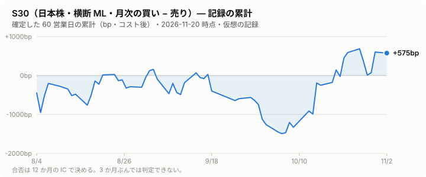

bot の全体: [`bot/トレード/戦略/S30.md`](bot/トレード/戦略/S30.md)

### S34

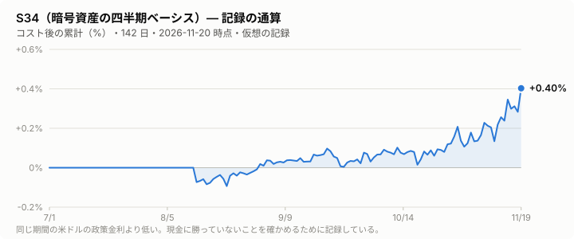

bot の全体: [`bot/トレード/戦略/S34.md`](bot/トレード/戦略/S34.md)

S68（暗号資産の横断モメンタム・週次）は記録が 2026-11-23 から、S17b（指数の買い持ち・観察枠）は 4 日ぶんしか無いので、図にしていない。

## 主な検証

### S21 の元になった検証（Q515）の検証期間

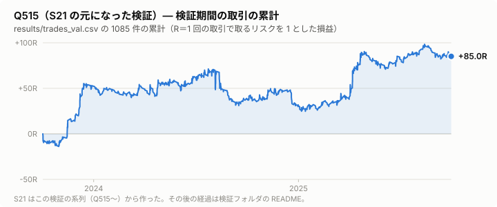

検証フォルダ: [`11_ML方向予測/s21-h1-ml-rr-weekcap-q515/`](11_ML方向予測/s21-h1-ml-rr-weekcap-q515/)

### S23 の元になった検証（Q529）の最終 1 年

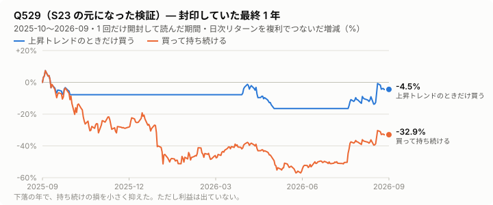

検証フォルダ: [`01_時系列モメンタム/s23-crypto-uptrend-long-q529/`](01_時系列モメンタム/s23-crypto-uptrend-long-q529/)

## 検証の中で作った図（主なもの）

### S21 の系列の比較（Q518 と Q519）

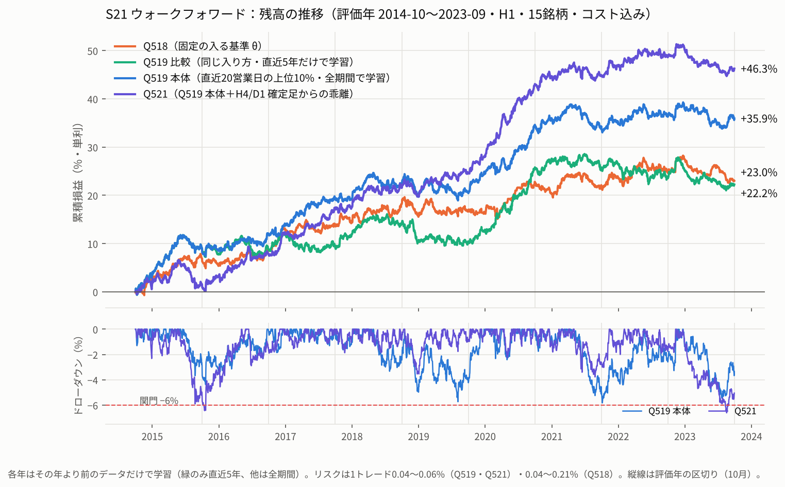

検証の中で作った図。検証フォルダ: [`11_ML方向予測/s21-h1-ml-rr-weekcap-q515/`](11_ML方向予測/s21-h1-ml-rr-weekcap-q515/)

### S23 の固定した数値の面（Q537）

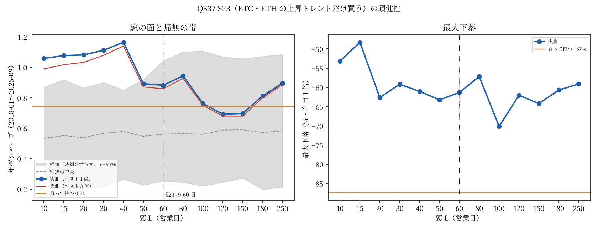

検証の中で作った図。検証フォルダ: [`01_時系列モメンタム/s23-crypto-uptrend-long-q529/`](01_時系列モメンタム/s23-crypto-uptrend-long-q529/)

### 生き残った 3 本の損益と合成

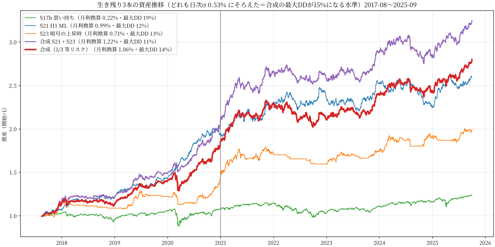

検証の中で作った図。検証フォルダ: [`18_リスク管理・戦略の合成/survivors-correlation-composite/`](18_リスク管理・戦略の合成/survivors-correlation-composite/)
